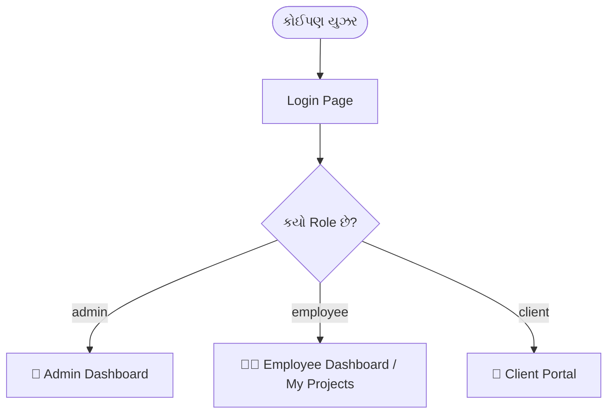
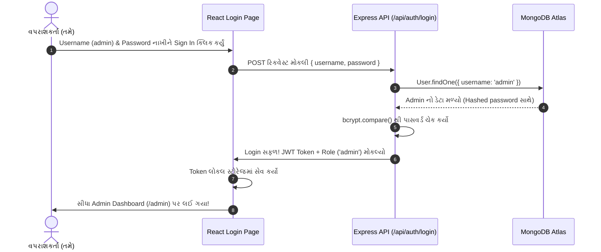

# 📘 DevVault / Company Project - સંપૂર્ણ ગુજરાતી ગાઈડ (Full Project Guide)

આ ડોક્યુમેન્ટ ખાસ તમારી સમજણ માટે બનાવવામાં આવ્યું છે, જેથી તમને આખા પ્રોજેક્ટની એકે-એક વસ્તુ (Frontend, Backend, Database, User Roles અને Coding Structure) એકદમ સરળ ભાષામાં સમજાઈ જાય.

---

## 🌟 ૧. આ પ્રોજેક્ટ શું છે? (What is this Project?)

આ પ્રોજેક્ટનું નામ **DevVault (Company Project Portal)** છે.
આ એક **MERN Stack વેબ એપ્લિકેશન** છે જે કંપનીના:
1. **Employees (કર્મચારીઓ)**
2. **Projects & Files (પ્રોજેક્ટ્સ, ફોલ્ડર્સ અને કોડ ફાઈલો)**
3. **Office Resources (ઑફિસ ડૉક્યુમેન્ટ્સ અને રિસોર્સીસ)**
4. **Client Portals (ક્લાયન્ટ માટેની લિંક્સ અને બિઝનેસ વિગતો)**

આ બધું એક જ જગ્યાએથી સુરક્ષિત રીતે મેનેજ કરવા માટે બનાવવામાં આવ્યું છે.

---

## 🛠️ ૨. ટેકનોલોજી સ્ટેક (Tech Stack - શું વપરાયું છે?)

| ભાગ | ટેકનોલોજી | શા માટે વપરાય છે? |
|---|---|---|
| **Frontend** | **React 19 + Vite** | ઝડપી અને મોર્ડન યૂઝર ઈન્ટરફેસ (UI) બનાવવા |
| **Styling** | **Tailwind CSS v4** | મોર્ડન, ગ્લાસમોર્ફિઝમ અને ડાર્ક/લાઈટ મોડ ડિઝાઇન માટે |
| **Animations & Icons** | **Framer Motion + Lucide React** | સ્મૂધ એનિમેશન અને આઇકોન્સ માટે |
| **Backend** | **Node.js + Express.js** | સર્વર અને REST APIs હેન્ડલ કરવા માટે |
| **Database** | **MongoDB Atlas (Mongoose)** | ક્લાઉડ ડેટાબેઝમાં ડેટા સાચવવા માટે |
| **Authentication** | **JWT (JSON Web Token) + Bcrypt** | સુરક્ષિત પાસવર્ડ હેશિંગ અને લોગિન ટોકન માટે |
| **File Upload** | **Multer** | ફાઈલો, ફોલ્ડર્સ અને થંબનેલ્સ સર્વર પર અપલોડ કરવા |

---

## 👥 ૩. ત્રણ પ્રકારના યૂઝર્સ (User Roles & Permissions)

આ સિસ્ટમમાં ૩ પ્રકારના લોકો લોગિન કરી શકે છે:



### ૧. 👑 Admin (મુખ્ય એડમિન):
* **Username:** `admin` | **Password:** `adminpassword`
* **સત્તા (Permissions):**
  * નવા ડિપાર્ટમેન્ટ્સ (IT, Sales, HR વગેરે) ઉમેરવા/ડિલીટ કરવા.
  * નવા Employees બનાવવા, તેમને ડિપાર્ટમેન્ટ ફાળવવો, પાસવર્ડ બદલવો કે ડીલીટ કરવા.
  * બધા કર્મચારીઓએ અપલોડ કરેલા તમામ પ્રોજેક્ટ્સ જોવા, ફિલ્ટર કરવા અને ડિલીટ કરવા.
  * ક્લાયન્ટ લિંક્સ મેનેજ કરવી.

### ૨. 👨‍💻 Employee (કર્મચારી):
* **ઉદાહરણ:** `shyam`, `manav`, `rohit`
* **સત્તા (Permissions):**
  * પોતાના બનાવેલા પ્રોજેક્ટ્સ (ફાઈલો, ફોલ્ડર્સ, Github લિંક, Live ડેમો લિંક) અપલોડ કરવા.
  * ઑફિસ સ્કોપના કોમન પ્રોજેક્ટ્સ જોવા.
  * પોતાની પ્રોફાઈલ અને પાસવર્ડ અપડેટ કરવો.

### ૩. 🤝 Client (ગ્રાહક):
* **ઉદાહરણ:** `testclient` | **Password:** `clientpassword`
* **સત્તા (Permissions):**
  * ફક્ત પોતાના બિઝનેસ અને કેટેગરી (દા.ત. CA, Web, Marketing) ને લગતી ડેમો લિંક્સ જોવી.

---

## 📁 ૪. ફોલ્ડર સ્ટ્રક્ચર (Folder Structure Explained)

પ્રોજેક્ટ બે મુખ્ય ભાગમાં વહેંચાયેલો છે:

```
comapny_project/
├── 📁 server/    --> Backend (Node + Express + MongoDB)
└── 📁 client/    --> Frontend (React + Vite + Tailwind)
```

### 🔵 Backend (`server/`) ફોલ્ડર:
* [`server/server.js`](file:///d:/comapny_project/server/server.js): મુખ્ય એન્ટ્રી પોઇન્ટ. અહીં Express સર્વર શરુ થાય છે અને MongoDB સાથે કનેક્ટ થાય છે.
* [`server/.env`](file:///d:/comapny_project/server/.env): ગુપ્ત ચાવીઓ (PORT=5005, MongoDB URL, JWT Secret).
* [`server/models/`](file:///d:/comapny_project/server/models/): ડેટાબેઝના ટેબલ્સ (Schemas):
  * `User.js`: વપરાશકર્તાની વિગતો (username, password, role, department).
  * `Project.js`: પ્રોજેક્ટની વિગતો (title, files, githubUrl, liveUrl, thumbnail, employeeId).
  * `Department.js`: ઑફિસ ડિપાર્ટમેન્ટ્સ (IT, Design વગેરે).
  * `ClientLink.js`: ક્લાયન્ટ માટેની લિંક્સ.
* [`server/controllers/`](file:///d:/comapny_project/server/controllers/): બધો મુખ્ય લોજિક (ડેટાબેઝમાંથી ડેટા લાવવો, નવો સેવ કરવો, પાસવર્ડ ચેક કરવો).
* [`server/routes/`](file:///d:/comapny_project/server/routes/): API Endpoints (URL પાથ જેમ કે `/api/auth/login`, `/api/projects`).
* [`server/middleware/`](file:///d:/comapny_project/server/middleware/):
  * `authMiddleware.js`: ચેક કરે છે કે યુઝર લોગિન છે કે નહિ (Token વેરીફાય કરે).
  * `uploadMiddleware.js`: Multer વડે ફાઈલો અને ફોલ્ડર્સ અપલોડ કરે.
* [`server/uploads/`](file:///d:/comapny_project/server/uploads/): અપલોડ થયેલી બધી ફાઈલો અને ફોટાઓ અહીં સેવ થાય છે.

---

### 🟢 Frontend (`client/`) ફોલ્ડર:
* [`client/src/main.jsx`](file:///d:/comapny_project/client/src/main.jsx): React ની શરૂઆત.
* [`client/src/App.jsx`](file:///d:/comapny_project/client/src/App.jsx): રાઉટિંગ (URLs) નક્કી કરે છે (`/login`, `/admin`, `/dashboard`).
* [`client/src/api.js`](file:///d:/comapny_project/client/src/api.js): Axios કન્ફિગરેશન જે બેકેન્ડ સાથે વાત કરે છે (`http://localhost:5005/api`).
* [`client/src/context/AuthContext.jsx`](file:///d:/comapny_project/client/src/context/AuthContext.jsx): આખા એપમાં યુઝર લોગિન છે કે નહિ તેનું સ્ટેટ સાચવે છે.
* [`client/src/pages/`](file:///d:/comapny_project/client/src/pages/): દરેક પેજ:
  * `Login.jsx`: લોગિન સ્ક્રીન (WebGL Smokey એનિમેશન સાથે).
  * `AdminDashboard.jsx`: એડમિન માટે આંકડા (કુલ પ્રોજેક્ટ્સ, કર્મચારીઓ).
  * `AdminProjects.jsx`: બધા જ પ્રોજેક્ટ્સ લિસ્ટ અને ડિલીટ.
  * `Departments.jsx`: ડિપાર્ટમેન્ટ મેનેજમેન્ટ.
  * `Employees.jsx`: કર્મચારીઓનું મેનેજમેન્ટ.
  * `MyProjects.jsx`: કર્મચારીનો પોતાનો વર્કસ્પેસ.
  * `Office.jsx`: ઑફિસ લાયબ્રેરી.
  * `Client.jsx` / `ClientPortal.jsx`: ક્લાયન્ટ પોર્ટલ.
* [`client/src/components/`](file:///d:/comapny_project/client/src/components/):
  * `Navbar.jsx`: ઉપરનો હેડર (ડાર્ક મોડ, સર્ચ, પ્રોફાઈલ).
  * `Sidebar.jsx`: ડાબી બાજુનું મેનુ.
  * `ProjectEngine.jsx`: નવો પ્રોજેક્ટ કે ફોલ્ડર અપલોડ કરવાનું મોડલ (Popup).

---

## 🔄 ૫. ડેટા કેવી રીતે કામ કરે છે? (Real Example Flow)

ધારો કે તમે **Admin તરીકે Login** કરો છો, તો અંદર શું થાય છે?



તેવી જ રીતે જ્યારે તમે **પ્રોજેક્ટ અપલોડ** કરો છો:
1. `ProjectEngine` માંથી ફાઈલ અથવા આખું ફોલ્ડર પસંદ કરો છો.
2. `Multer` તે ફાઈલને `server/uploads/` માં સેવ કરે છે.
3. `Project` મોડેલ MongoDB માં પ્રોજેક્ટનું ટાઇટલ, ફાઈલ પાથ અને અપલોડ કરનારનું નામ સેવ કરે છે.
4. તરત જ સ્ક્રીન પર નવો પ્રોજેક્ટ કાર્ડ સ્વરૂપે દેખાઈ આવે છે!

---

## 🚀 ૬. પ્રોજેક્ટ કેવી રીતે ચલાવવો (How to Run Daily)

જ્યારે પણ તમારે કામ કરવું હોય, ત્યારે ૨ ટર્મિનલ ખોલવા:

### ટર્મિનલ ૧ (Backend ચલાવવા):
```powershell
cd d:\comapny_project\server
npm run dev
```
*(સર્વર `http://localhost:5005` પર ચાલુ થશે અને MongoDB સાથે કનેક્ટ થશે)*

### ટર્મિનલ ૨ (Frontend ચલાવવા):
```powershell
cd d:\comapny_project\client
npm run dev
```
*(તમારું React App `http://localhost:5173` પર ખૂલશે)*

---

## 🔑 ૭. યાદ રાખવા જેવી મહત્વની બાબતો (Quick Tips)

1. **સર્વર કનેક્શન:** MongoDB Atlas કનેક્ટ કરવા માટે `server.js` માં `dns.setServers(['8.8.8.8', '8.8.4.4'])` મૂકેલું છે, જેથી કોઈ પણ વાઇફાઇ કે ઈન્ટરનેટ પર કનેક્શન બ્લોક ન થાય.
2. **મોટી ફાઈલો:** સર્વરમાં `2000mb` સુધીના પ્રોજેક્ટ્સ અને ફોલ્ડર્સ અપલોડ કરવાની ક્ષમતા સેટ કરેલી છે.
3. **થીમ સપોર્ટ:** આખી એપ્લિકેશનમાં ડાર્ક મોડ અને લાઈટ મોડ બંને સપોર્ટેડ છે (ઉપરના સન/મૂન આઇકોન પર ક્લિક કરીને બદલી શકાય છે).

---
*આ ડોક્યુમેન્ટ પ્રોજેક્ટના રૂટ ફોલ્ડરમાં `PROJECT_GUIDE_GUJARATI.md` તરીકે હંમેશા હાજર રહેશે.*
