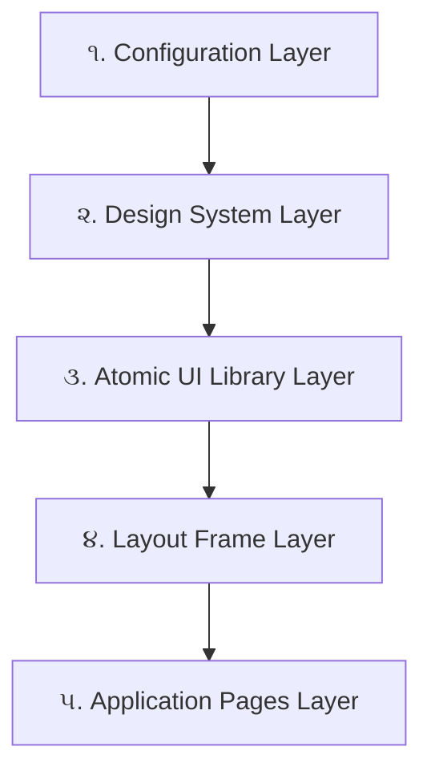

# 🏛️ DevVault - UI Architecture, Changelog & Developer Guide

> **આ ડોક્યુમેન્ટનું પ્રયોજન:** 
> આ ફાઈલ તમારા પ્રોજેક્ટની **UI આર્કિટેક્ચર માર્ગદર્શિકા (Architecture Blueprint)** છે. તમે અથવા તમારી ટીમના કોઈપણ નવા ડેવલપર આ ફાઈલ વાંચીને તરત સમજી શકશે કે પ્રોજેક્ટમાં શું-શું ફેરફારો થયા છે, શા માટે થયા છે, અને ભવિષ્યમાં કોઈપણ નવું પેજ કે UI ફીચર કેવી રીતે બનાવવું જેથી કોડ ૧૦૦% ક્લીન અને કન્સિસ્ટન્ટ રહે.

---

## 📑 અનુક્રમણિકા (Table of Contents)
1. [વિગતવાર ફેરફારોનો રિપોર્ટ (Changelog Report)](#૧-વિગતવાર-ફેરફારોનો-રિપોર્ટ-changelog-report)
2. [નવું UI આર્કિટેક્ચર (New UI Architecture)](#૨-નવું-ui-આર્કિટેક્ચર-new-ui-architecture)
3. [કોર UI કમ્પોનન્ટ્સનો ઉપયોગ (How to Use Core UI Kit)](#૩-કોર-ui-કમ્પોનન્ટ્સનો-ઉપયોગ-how-to-use-core-ui-kit)
4. [ડેવલપર્સ માટેના નિયમો (Do's & Don'ts for Developers)](#૪-ડેવલપર્સ-માટેના-નિયમો-dos--donts)
5. [નવું ફીચર/પેજ ઉમેરવાનું સ્ટેપ-બાય-સ્ટેપ ઉદાહરણ](#૫-નવું-પેજ-કે-ફીચર-ઉમેરવાનું-સ્ટેપ-બાય-સ્ટેપ-ઉદાહરણ)

---

## ૧. વિગતવાર ફેરફારોનો રિપોર્ટ (Changelog Report)

નીચે મુજબના ૫ મુખ્ય લેયર્સમાં ફેરફારો કરવામાં આવ્યા છે:



---

### સ્તર ૧: Configuration & Aliases (રૂટ સેટઅપ)
* **કઈ ફાઈલો બદલાઈ:** [`client/vite.config.js`](file:///d:/comapny_project/client/vite.config.js), [`client/tsconfig.json`](file:///d:/comapny_project/client/tsconfig.json), [`.vscode/settings.json`](file:///d:/comapny_project/.vscode/settings.json)
* **શા માટે બદલી:** પહેલા ડેવલપર્સને `../../components/ui/Button` જેવા અટપટા લાંબા પાથ લખવા પડતા હતા, જેમાં વારંવાર સ્પેલિંગ અને પાથ એરર થતી હતી.
* **પરિણામ:** 
  * હવે સીધું જ `@/components/ui` લખીને ગમે ત્યાંથી ઈમ્પોર્ટ કરી શકાય છે.
  * Node.js ESM સ્ટાન્ડર્ડ `fileURLToPath(new URL('./src', import.meta.url))` સેટ કર્યું જેથી વિન્ડોઝમાં પાથ ક્રેશ ન થાય.
  * `typescript` સ્કેનર ટૂલ ઉમેર્યું જેથી `npx tsc --noEmit` થી ૧ સેકન્ડમાં આખા પ્રોજેક્ટની હેલ્થ ચેક થઈ શકે.

---

### સ્તર ૨: Global Design System & Tokens ([`index.css`](file:///d:/comapny_project/client/src/index.css))
* **કઈ ફાઈલો બદલાઈ:** [`client/src/index.css`](file:///d:/comapny_project/client/src/index.css)
* **શા માટે બદલી:** પહેલા કોઈ કન્સિસ્ટન્ટ થીમ નહોતી. જુદી જુદી જગ્યાએ મનફાવે તેવા કલર્સ અને ઓવરરાઈડિંગ ક્લાસીસ હતા.
* **પરિણામ:**
  * **લક્ઝરી ડાર્ક મોડ:** Deep Slate/Midnight (`#070a12`) બેકગ્રાઉન્ડ.
  * **એક્સેન્ટ કલર્સ:** Electric Indigo (`#6366f1`) અને Neon Cyan (`#06b6d4`).
  * **ગ્લાસમોર્ફિઝમ:** `.glass-card` અને `.glass-panel` ક્લાસીસથી બેકગ્રાઉન્ડ બ્લર અને હોવર માઇક્રો-એનિમેશન ઉમેરાયા.
  * **કસ્ટમ સ્ક્રોલબાર:** સ્લીક અને અદ્રશ્ય જેવા મોર્ડન સ્ક્રોલબાર.

---

### સ્તર ૩: Core UI Component Library ([`src/components/ui/`](file:///d:/comapny_project/client/src/components/ui/))
* **નવા કમ્પોનન્ટ્સ બનાવ્યા:**
  1. [`Button.jsx`](file:///d:/comapny_project/client/src/components/ui/Button.jsx): Primary, Secondary, Outline, Danger, Success વેરિયન્ટ્સ અને બિલ્ટ-ઇન `loading` સ્પિનર.
  2. [`Card.jsx`](file:///d:/comapny_project/client/src/components/ui/Card.jsx): CardHeader, CardTitle, CardDescription, CardContent, CardFooter સાથેનું ગ્લાસ કાર્ડ.
  3. [`Input.jsx`](file:///d:/comapny_project/client/src/components/ui/Input.jsx): આઇકોન પ્રીફિક્સ, લેબલ, એરર મેસેજ અને ડાર્ક મોડ રેડી ઇનપુટ.
  4. [`Badge.jsx`](file:///d:/comapny_project/client/src/components/ui/Badge.jsx): પલ્સિંગ ડોટ સાથેના સ્ટેટસ બેજિસ.
  5. [`Modal.jsx`](file:///d:/comapny_project/client/src/components/ui/Modal.jsx): Framer Motion એનિમેશન, ESC કી લિસનર અને બેકગ્રાઉન્ડ બ્લર વાળું પોપઅપ.
  6. [`index.js`](file:///d:/comapny_project/client/src/components/ui/index.js) / [`index.jsx`](file:///d:/comapny_project/client/src/components/ui/index.jsx): Barrel Export જેથી ડેવલપર ૧ લાઈનમાં બધું મંગાવી શકે.
* **શા માટે બનાવ્યા:** હવે કોઈ ડેવલપરે પેજની અંદર જાતે `<button className="...">` કે પોપઅપ કોડ કરવાનો રહેશે નહીં.
* **પરિણામ:** આખી વેબસાઈટનો લુક ૧૦૦% એકસમાન અને સુપર પ્રીમિયમ બની ગયો.

---

### સ્તર ૪: Layout Frame (Sidebar & Navbar)
* **કઈ ફાઈલો બદલાઈ:** [`Sidebar.jsx`](file:///d:/comapny_project/client/src/components/Sidebar.jsx), [`Navbar.jsx`](file:///d:/comapny_project/client/src/components/Navbar.jsx)
* **શા માટે બદલી:**
  * Sidebar માં જૂની ટાઈપો "Company Wroks" હતી અને મેનુ સાદા હતા.
  * Navbar માં થીમ બદલવા માટે સહેલો રસ્તો ન હતો.
* **પરિણામ:**
  * **Sidebar:** "DevVault" ગ્રેડિયન્ટ લોગો, એક્ટિવ પેજ પર ગ્લો પિલ, યુઝર રોલ બેજ અને રેડ હોવર વાળું ક્લીન લોગઆઉટ બટન.
  * **Navbar:** ગ્લાસ હેડર, **Sun/Moon આઇકોન વાળું Dark/Light મોડ સ્વિચર**, સ્માર્ટ સર્ચ અને એનિમેટેડ પ્રોફાઈલ ડ્રોપડાઉન.

---

### સ્તર ૫: Application Pages Revamp
* **કયા પેજીસ અપગ્રેડ થયા:**
  1. [`AdminDashboard.jsx`](file:///d:/comapny_project/client/src/pages/AdminDashboard.jsx): Stats ગ્રીડ, મેનેજમેન્ટ શોર્ટકટ્સ અને સિસ્ટમ હેલ્થ કાર્ડ.
  2. [`Departments.jsx`](file:///d:/comapny_project/client/src/pages/Departments.jsx): નવું ડિપાર્ટમેન્ટ એડ/એડિટ મોડલ અને કાર્ડ લિસ્ટિંગ.
  3. [`Employees.jsx`](file:///d:/comapny_project/client/src/pages/Employees.jsx): પ્રોફેશનલ ટેબલ, પાસવર્ડ રીસેટ મોડલ અને યુઝર ક્રિએશન.
  4. [`AdminProjects.jsx`](file:///d:/comapny_project/client/src/pages/AdminProjects.jsx): પ્રોજેક્ટ કાર્ડ્સ, થંબનેલ પ્રિવ્યૂ, ગિટહબ/લાઈવ લિંક્સ અને ક્લિયર ફિલ્ટર ચિપ્સ.
  5. [`ClientPortal.jsx`](file:///d:/comapny_project/client/src/pages/ClientPortal.jsx): સમર્પિત ક્લાયન્ટ લિંક્સ પોર્ટલ.

---

## ૨. નવું UI આર્કિટેક્ચર (New UI Architecture)

ભવિષ્યમાં પ્રોજેક્ટનું માળખું આ નિયમ પ્રમાણે જળવાશે:

```
client/src/
├── 📁 components/
│   ├── 📁 ui/             <-- 🧱 પાયાના Reusable કમ્પોનન્ટ્સ (Button, Card, Input, Modal, Badge)
│   │   ├── Button.jsx
│   │   ├── Card.jsx
│   │   ├── Input.jsx
│   │   ├── Badge.jsx
│   │   ├── Modal.jsx
│   │   ├── index.js       <-- બધાનું કેન્દ્રીય એક્સપોર્ટ
│   │   └── ...
│   ├── Navbar.jsx         <-- હેડર
│   ├── Sidebar.jsx        <-- મેનુ
│   └── ProjectEngine.jsx  <-- મોટું પ્રોજેક્ટ અપલોડ મોડલ
│
├── 📁 pages/              <-- 📄 ફક્ત પેજ કમ્પોઝિશન (કોઈ મોટો કાચો UI કોડ નહીં)
│   ├── AdminDashboard.jsx
│   ├── Employees.jsx
│   └── ...
│
├── 📁 context/            <-- ગ્લોબલ સ્ટેટ (AuthContext)
├── api.js                 <-- બેકેન્ડ API કનેક્ટર
└── index.css              <-- ડિઝાઇન ટોકન્સ અને ગ્લાસમોર્ફિઝમ
```

---

## ૩. કોર UI કમ્પોનન્ટ્સનો ઉપયોગ (How to Use Core UI Kit)

કોઈપણ ડેવલપરે પેજ બનાવતી વખતે સીધું આ કમ્પોનન્ટ્સ વાપરવાના છે:

### ૧. Button Component:
```jsx
import { Button } from '@/components/ui';
import { Plus, Trash2 } from 'lucide-react';

// પ્રાઈમરી બટન
<Button variant="primary" icon={Plus}>Add Employee</Button>

// લોડિંગ સ્પિનર સાથે બટન (API કોલ વખતે)
<Button loading={isSaving}>Save Changes</Button>

// સેકન્ડરી કે કેન્સલ બટન
<Button variant="secondary" onClick={onClose}>Cancel</Button>

// ડેન્જર (Delete) બટન
<Button variant="danger" icon={Trash2}>Delete Project</Button>
```

### ૨. Card Component:
```jsx
import { Card } from '@/components/ui';

<Card hover={true}>
  <h3 className="text-lg font-bold">Project Title</h3>
  <p className="text-xs text-slate-400">Description here...</p>
</Card>
```

### ૩. Input Component:
```jsx
import { Input } from '@/components/ui';
import { User, Lock } from 'lucide-react';

<Input 
  label="Username" 
  icon={User} 
  placeholder="Enter username" 
  value={username} 
  onChange={(e) => setUsername(e.target.value)} 
  error={formError} // જો એરર હોય તો લાલ અક્ષરે દેખાશે
/>
```

### ૪. Modal Component:
```jsx
import { Modal, Button } from '@/components/ui';

<Modal 
  isOpen={isModalOpen} 
  onClose={() => setIsModalOpen(false)} 
  title="Create New Project"
  description="Fill out the project details below"
  size="md" // 'sm' | 'md' | 'lg' | 'xl'
>
  <div>તમારું ફોર્મ અહીં મૂકો...</div>
</Modal>
```

### ૫. Badge Component:
```jsx
import { Badge } from '@/components/ui';

<Badge variant="primary" dot={true}>Admin</Badge>
<Badge variant="success">Active</Badge>
<Badge variant="cyan">CA Portal</Badge>
<Badge variant="danger">Deleted</Badge>
```

---

## ૪. ડેવલપર્સ માટેના નિયમો (Do's & Don'ts)

| ❌ ખોટી રીત (Don't do this) | ✅ સાચી રીત (Always do this) |
|---|---|
| પેજમાં સીધું `<button className="bg-blue-600 px-4 py-2 ...">` લખવું | `import { Button } from '@/components/ui'` વાપરવું |
| `../../components/ui/Button` લખવું | `@/components/ui` વાપરવું |
| દરેક પેજમાં જાતે `fixed inset-0 bg-black/50` વાળું પોપઅપ બનાવવું | `<Modal isOpen={...} onClose={...}>` વાપરવું |
| મનફાવે તેવા હાર્ડકોડેડ કલર્સ (`#123456`) વાપરવા | Tailwind થીમ ક્લાસીસ (`text-indigo-500`, `glass-card`) વાપરવા |
| કામ પૂરું કર્યા પછી ચેક કર્યા વિના પુશ કરવું | ટર્મિનલમાં `npx tsc --noEmit` રન કરીને 0 error ની ખાતરી કરવી |

---

## ૫. નવું પેજ કે ફીચર ઉમેરવાનું સ્ટેપ-બાય-સ્ટેપ ઉદાહરણ

ધારો કે તમારે કે તમારી ટીમના ડેવલપરે **"Reports"** નામનું નવું પેજ બનાવવું છે:

### પગલું ૧: પેજ ફાઈલ બનાવો (`src/pages/Reports.jsx`)
```jsx
import React, { useState } from 'react';
import { Button, Card, Badge, Modal } from '@/components/ui';
import { FileText, Download } from 'lucide-react';

const Reports = () => {
    const [isExportOpen, setIsExportOpen] = useState(false);

    return (
        <div className="space-y-6 max-w-7xl mx-auto">
            {/* Header */}
            <div className="flex justify-between items-center pb-4 border-b border-slate-200/60 dark:border-slate-800/60">
                <div>
                    <h1 className="text-2xl font-bold text-slate-900 dark:text-white">Reports Vault</h1>
                    <p className="text-xs text-slate-400 mt-1">Download and audit analytics.</p>
                </div>
                <Button icon={Download} onClick={() => setIsExportOpen(true)}>
                    Export PDF
                </Button>
            </div>

            {/* Content Cards */}
            <div className="grid grid-cols-1 md:grid-cols-3 gap-6">
                <Card>
                    <Badge variant="success" dot={true}>Live Status</Badge>
                    <h3 className="text-base font-bold mt-2">Q3 Performance</h3>
                    <p className="text-xs text-slate-400 mt-1">All departments operating normally.</p>
                </Card>
            </div>

            {/* Modal */}
            <Modal isOpen={isExportOpen} onClose={() => setIsExportOpen(false)} title="Export Options">
                <p className="text-sm text-slate-500">Select formats and date range to export.</p>
            </Modal>
        </div>
    );
};

export default Reports;
```

### પગલું ૨: `App.jsx` માં Route ઉમેરો
```jsx
<Route path="/admin/reports" element={
  <ProtectedRoute adminOnly>
    <Reports />
  </ProtectedRoute>
} />
```

### પગલું ૩: `Sidebar.jsx` માં લિંક ઉમેરો
```javascript
{ name: 'Reports', path: '/admin/reports', icon: FileText },
```

### પગલું ૪: કોડ ચેક કરો
ટર્મિનલમાં ફક્ત આ કમાન્ડ રન કરો:
```powershell
npx tsc --noEmit
```
જો કોઈ ભૂલ નહીં હોય તો આઉટપુટ એકદમ ક્લીન આવશે!

---

*આ ફાઈલ પ્રોજેક્ટના રૂટમાં `UI_ARCHITECTURE_AND_CHANGELOG.md` તરીકે સેવ થયેલી છે.*
